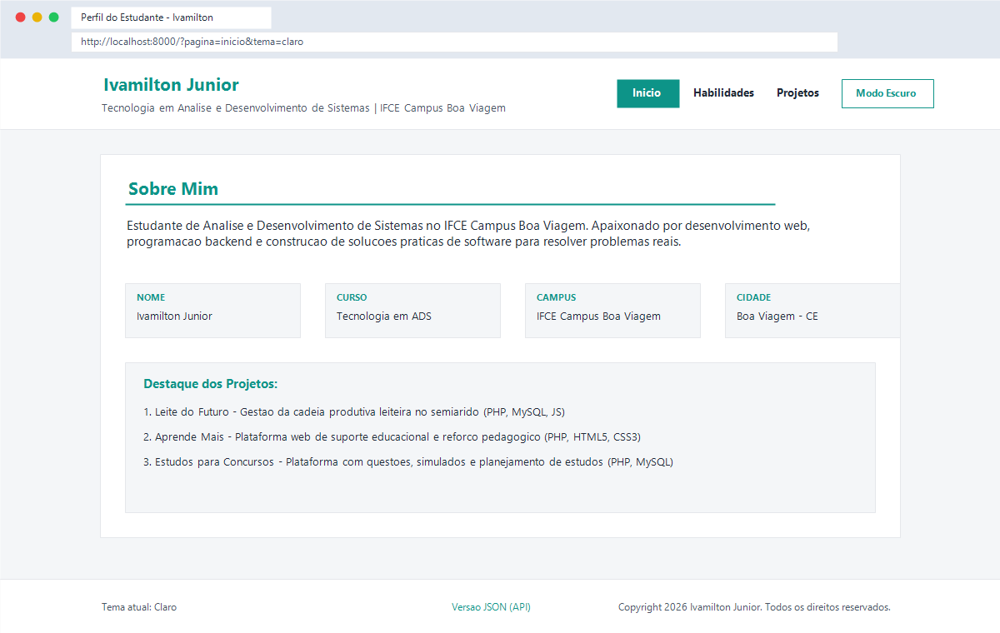
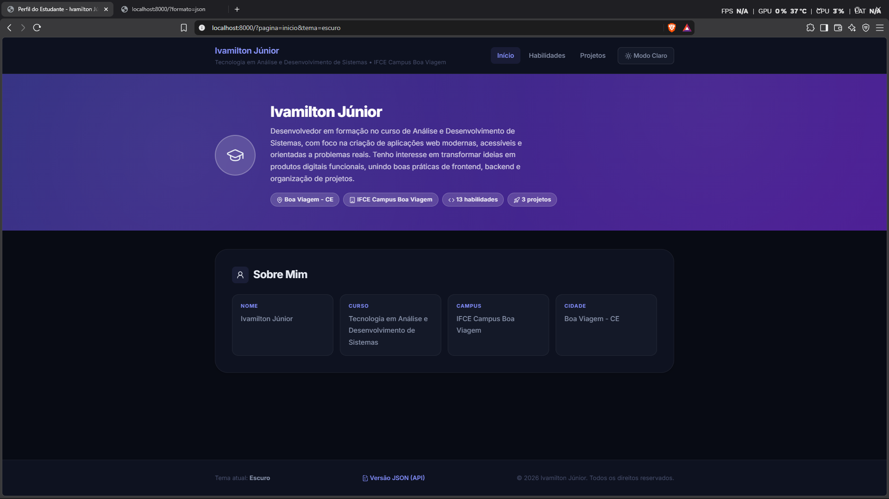

# Atividade Integrada 01 - Versão 1: Perfil do Estudante

**Disciplina:** Programação Web I  
**Curso:** Tecnologia em Análise e Desenvolvimento de Sistemas (ADS)  
**Instituição:** IFCE Campus Boa Viagem  
**Professor:** Prof. Dr. Renato William Rodrigues de Souza  
**Estudante:** Ivamilton Júnior  

---

## 1. Telas da Aplicação

### Tema Claro
Abaixo está a captura da aplicação renderizada no modo claro (`.tema-claro`):



### Tema Escuro
Abaixo está a captura da aplicação renderizada no modo escuro (`.tema-escuro`), persistido via cookie:



---

## 2. Mapa de Rotas

O roteamento da aplicação é centralizado no arquivo `index.php`, sendo gerenciado dinamicamente pelos parâmetros recebidos via *query string*:

| Método | URL / Query String | Descrição do Conteúdo | Status HTTP |
| :--- | :--- | :--- | :--- |
| `GET` | `/` ou `/?pagina=inicio` | Apresentação pessoal com dados biográficos, curso, campus e cidade do estudante. | `200 OK` |
| `GET` | `/?pagina=habilidades` | Listagem das habilidades técnicas, exibindo a contagem com `count()` e a relação com `implode()`. | `200 OK` |
| `GET` | `/?pagina=projetos` | Catálogo de projetos desenvolvidos (Leite do Futuro, Aprende Mamis e Estudos para Concursos) com links para detalhes. | `200 OK` |
| `GET` | `/?pagina=projeto&id=1` | Visão detalhada do projeto 1 (*Leite do Futuro*), contendo descrição aprofundada e tecnologias. | `200 OK` |
| `GET` | `/?pagina=projeto&id=2` | Visão detalhada do projeto 2 (*Aprende Mamis*). | `200 OK` |
| `GET` | `/?pagina=projeto&id=3` | Visão detalhada do projeto 3 (*Plataforma de Estudos para Concursos*). | `200 OK` |
| `GET` | `/?pagina=projeto&id=99` | Resposta para projeto com ID inexistente. Exibe a mensagem "Projeto não encontrado". | `404 Not Found` |
| `GET` | `/?pagina=qualquercoisa` | Resposta para qualquer rota inexistente. Exibe a mensagem "Página não encontrada". | `404 Not Found` |
| `GET` | `/?tema=escuro` | Aplica o tema escuro na página atual e grava a escolha no cookie `tema` por 30 dias. | `200 OK` |
| `GET` | `/?tema=claro` | Aplica o tema claro e grava a preferência no cookie. | `200 OK` |
| `GET` | `/?tema=<script>` | Teste de segurança contra XSS: valor malicioso é sanitizado, revertendo ao tema padrão `claro`. | `200 OK` |
| `GET` | `/?formato=json` | Endpoint de API REST: envia cabeçalho JSON e o corpo com os arrays `$perfil` e `$projetos`, sem HTML. | `200 OK` |

---

## 3. Saídas do Terminal e Análise Linha por Linha

### 3.1. Página que existe: Início (`/?pagina=inicio`)

```text
HTTP/1.1 200 OK
Host: localhost:8000
Date: Wed, 14 Oct 2026 16:59:38 GMT
Connection: close
X-Powered-By: PHP/8.2.33
Content-type: text/html; charset=UTF-8

<!DOCTYPE html>
<html lang="pt-BR">
...
```

**Explicação linha por linha:**
1. `HTTP/1.1 200 OK`: Linha de status da resposta informando o protocolo (`HTTP/1.1`), o código `200` indicando sucesso e a frase descritiva `OK`.
2. `Host: localhost:8000`: Cabeçalho informando o domínio e a porta do servidor local.
3. `Date: Wed, 14 Oct 2026 16:59:38 GMT`: Data e horário GMT em que o servidor web gerou e processou a resposta.
4. `Connection: close`: Indica que a conexão TCP será finalizada após a entrega do recurso.
5. `X-Powered-By: PHP/8.2.33`: Cabeçalho informativo gerado pelo servidor embutido do PHP apontando a versão do interpretador.
6. `Content-type: text/html; charset=UTF-8`: Define o tipo MIME do conteúdo como documento HTML codificado em UTF-8.
7. Linha em branco: Divisor obrigatório do padrão HTTP entre os cabeçalhos (*headers*) e o corpo (*body*).
8. `<!DOCTYPE html>...`: Corpo da resposta com o HTML gerado dinamicamente pelo PHP contendo o cartão de apresentação.

---

### 3.2. Página que não existe: Erro 404 (`/?pagina=xyz`)

```text
HTTP/1.1 404 Not Found
Host: localhost:8000
Date: Wed, 14 Oct 2026 17:03:48 GMT
Connection: close
X-Powered-By: PHP/8.2.33
Content-type: text/html; charset=UTF-8

<!DOCTYPE html>
...
<h2>Página não encontrada</h2>
```

**Explicação linha por linha:**
1. `HTTP/1.1 404 Not Found`: A linha de status retorna o código `404` configurado no backend com `http_response_code(404)`, informando que o recurso solicitado não existe.
2. `Host`, `Date`, `Connection`, `X-Powered-By`: Metadados da transação HTTP e do ambiente de execução.
3. `Content-type: text/html; charset=UTF-8`: Embora seja um erro, o servidor envia uma página HTML estilizada e legível ao usuário.
4. Linha em branco: Separação de cabeçalhos e corpo.
5. `<h2>Página não encontrada</h2>`: O PHP identificou no bloco de decisões que `xyz` não é uma rota conhecida e renderizou a mensagem informativa correspondente.

---

### 3.3. Projeto inexistente: Erro 404 (`/?pagina=projeto&id=99`)

```text
HTTP/1.1 404 Not Found
Host: localhost:8000
Date: Wed, 14 Oct 2026 17:01:31 GMT
Connection: close
X-Powered-By: PHP/8.2.33
Content-type: text/html; charset=UTF-8

<!DOCTYPE html>
...
<h2>Projeto não encontrado</h2>
```

**Explicação linha por linha:**
1. `HTTP/1.1 404 Not Found`: Status code 404 disparado porque o ID numérico 99 não existe no array `$projetos`.
2. Cabeçalhos HTTP: Identificadores padrão do servidor e formato de codificação da página de retorno.
3. Linha em branco: Fim dos cabeçalhos.
4. `<h2>Projeto não encontrado</h2>`: O PHP executou `isset($projetos[$id_projeto])`, avaliou como falso e configurou `$mensagem_erro_404 = 'Projeto não encontrado'`.

---

### 3.4. Troca de tema e gravação de cookie (`/?tema=escuro`)

```text
HTTP/1.1 200 OK
Host: localhost:8000
Date: Wed, 14 Oct 2026 17:04:06 GMT
Connection: close
X-Powered-By: PHP/8.2.33
Set-Cookie: tema=escuro; expires=Fri, 13 Nov 2026 17:04:06 GMT; Max-Age=2592000
Content-type: text/html; charset=UTF-8

<!DOCTYPE html>
...
<body class="tema-escuro">
```

**Explicação linha por linha:**
1. `HTTP/1.1 200 OK`: Requisição processada com êxito.
2. `Set-Cookie: tema=escuro; expires=Fri, 13 Nov 2026 17:04:06 GMT; Max-Age=2592000`: Cabeçalho enviado pelo comando `setcookie('tema', 'escuro', time() + 2592000)`. Instrui o navegador a armazenar o cookie `tema` com valor `escuro` durante 30 dias (2.592.000 segundos).
3. `<body class="tema-escuro">`: Na mesma requisição, o PHP já aplica a classe do tema escuro no elemento `body` porque a URL tem prioridade sobre os cookies salvos.

---

### 3.5. Persistência do tema via cookie na requisição seguinte (`/`)

```bash
curl.exe -i -s --cookie "tema=escuro" "http://localhost:8000/"
```

```text
HTTP/1.1 200 OK
Host: localhost:8000
Date: Wed, 14 Oct 2026 17:04:27 GMT
Connection: close
X-Powered-By: PHP/8.2.33
Content-type: text/html; charset=UTF-8

<!DOCTYPE html>
...
<body class="tema-escuro">
```

**Explicação linha por linha:**
1. O cliente enviou no cabeçalho `Cookie: tema=escuro`.
2. Como a URL não tinha o parâmetro `?tema=...`, o PHP leu `$_COOKIE['tema']` e preservou a preferência do usuário.
3. Não foi emitido novo cabeçalho `Set-Cookie`, evitando tráfego desnecessário.
4. O documento HTML foi renderizado com `<body class="tema-escuro">`.

---

### 3.6. Teste de segurança contra XSS (`/?tema=<script>`)

```bash
curl.exe -i -s "http://localhost:8000/?tema=<script>"
```

```text
HTTP/1.1 200 OK
Host: localhost:8000
Date: Wed, 14 Oct 2026 17:05:00 GMT
Connection: close
X-Powered-By: PHP/8.2.33
Set-Cookie: tema=claro; expires=Fri, 13 Nov 2026 17:05:00 GMT; Max-Age=2592000
Content-type: text/html; charset=UTF-8

<!DOCTYPE html>
...
<body class="tema-claro">
```

**Explicação linha por linha:**
1. A entrada maliciosa `<script>` recebida pela URL foi avaliada pela verificação estrita `($tema_bruto === 'escuro') ? 'escuro' : 'claro'`.
2. Como a entrada não é `'escuro'`, o backend reverteu com segurança para `'claro'`.
3. O cookie e a classe do `<body>` foram definidos estritamente como `tema-claro`, impedindo qualquer tentativa de injeção de scripts (XSS).

---

### 3.7. Endpoint de API em JSON (`/?formato=json`)

```bash
curl.exe -i -s "http://localhost:8000/?formato=json"
```

```text
HTTP/1.1 200 OK
Host: localhost:8000
Date: Wed, 14 Oct 2026 17:05:29 GMT
Connection: close
X-Powered-By: PHP/8.2.33
Content-Type: application/json; charset=utf-8

{
    "perfil": {
        "nome": "Ivamilton Júnior",
        "curso": "Tecnologia em Análise e Desenvolvimento de Sistemas",
        "campus": "IFCE Campus Boa Viagem",
        "cidade": "Boa Viagem - CE",
        "apresentacao": "Desenvolvedor em formação no curso de Análise e Desenvolvimento de Sistemas, com foco na criação de aplicações web modernas, acessíveis e orientadas a problemas reais. Tenho interesse em transformar ideias em produtos digitais funcionais, unindo boas práticas de frontend, backend e organização de projetos.",
        "habilidades": [
            "HTML5",
            "CSS3",
            "JavaScript",
            "React",
            "PHP",
            "Python",
            "PostgreSQL",
            "Git & GitHub",
            "Django",
            "Flask",
            "FastAPI",
            "Bootstrap",
            "APIs REST"
        ]
    },
    "projetos": {
        "1": {
            "titulo": "Leite do Futuro",
            "descricao": "Plataforma para modernizar a gestão da cadeia produtiva leiteira no semiárido cearense. Reúne dados de ordenha, sanidade do rebanho, custos e produtividade em uma experiência simples para apoiar decisões no campo.",
            "tecnologias": "React, Python, APIs REST, PostgreSQL"
        },
        "2": {
            "titulo": "Aprende Mamis",
            "descricao": "Plataforma educacional pensada para apoiar mães em sua jornada de aprendizagem. Oferece conteúdos organizados, trilhas de estudo, atividades interativas e acompanhamento da evolução de cada estudante.",
            "tecnologias": "React, Python, APIs REST, PostgreSQL"
        },
        "3": {
            "titulo": "Plataforma de Estudos para Concursos",
            "descricao": "Aplicação para planejar e otimizar a preparação para concursos públicos. Inclui banco de questões, simulados, ciclo de revisões e indicadores de desempenho por disciplina para tornar os estudos mais consistentes.",
            "tecnologias": "React, Python, APIs REST, PostgreSQL"
        }
    }
}
```

**Explicação linha por linha:**
1. `HTTP/1.1 200 OK`: Requisição atendida com êxito.
2. `Content-Type: application/json; charset=utf-8`: Cabeçalho que orienta navegadores e clientes HTTP (como Insomnia, curl e fetch) a interpretarem a resposta como JSON puro, e não como marcação HTML.
3. Linha em branco: Divisão obrigatória entre headers e corpo.
4. Objeto JSON: Dados estruturados serializados por `json_encode` com flags `JSON_PRETTY_PRINT` (formatação legível com quebras de linha e tabulação) e `JSON_UNESCAPED_UNICODE` (preserva acentuação em português sem converter em sequências unicode como `\u00fa`).
5. A chamada `exit;` logo em seguida encerra o fluxo do PHP imediatamente, garantindo que nenhum fragmento de HTML seja concatenado ao payload JSON.

---

### 3.8. Log do Servidor Embutido do PHP (`php -S`)

Abaixo estão os registros das requisições capturadas diretamente no console do servidor:

```text
[Wed Oct 14 14:01:31 2026] [::1]:59831 Accepted
[Wed Oct 14 14:01:31 2026] [::1]:59831 [404]: GET /?pagina=projeto&id=99
[Wed Oct 14 14:01:31 2026] [::1]:59831 Closing
[Wed Oct 14 14:03:48 2026] [::1]:59833 Accepted
[Wed Oct 14 14:03:48 2026] [::1]:59833 [404]: GET /?pagina=xyz
[Wed Oct 14 14:03:48 2026] [::1]:59833 Closing
[Wed Oct 14 14:04:06 2026] [::1]:59835 Accepted
[Wed Oct 14 14:04:06 2026] [::1]:59835 [200]: GET /?tema=escuro
[Wed Oct 14 14:04:06 2026] [::1]:59835 Closing
[Wed Oct 14 14:04:27 2026] [::1]:59837 Accepted
[Wed Oct 14 14:04:27 2026] [::1]:59837 [200]: GET /
[Wed Oct 14 14:04:27 2026] [::1]:59837 Closing
[Wed Oct 14 14:05:00 2026] [::1]:59838 Accepted
[Wed Oct 14 14:05:00 2026] [::1]:59838 [200]: GET /?tema=<script>
[Wed Oct 14 14:05:00 2026] [::1]:59838 Closing
[Wed Oct 14 14:05:29 2026] [::1]:59839 Accepted
[Wed Oct 14 14:05:29 2026] [::1]:59839 [200]: GET /?formato=json
[Wed Oct 14 14:05:29 2026] [::1]:59839 Closing
[Wed Oct 14 14:05:52 2026] [::1]:59841 Accepted
[Wed Oct 14 14:05:52 2026] [::1]:59841 [200]: GET /?pagina=habilidades
[Wed Oct 14 14:05:52 2026] [::1]:59841 Closing
[Wed Oct 14 14:06:47 2026] [::1]:51076 Accepted
[Wed Oct 14 14:06:47 2026] [::1]:51076 [200]: GET /?pagina=projeto&id=1
[Wed Oct 14 14:06:47 2026] [::1]:51076 Closing
```

**Explicação:**
- Cada conexão aberta pelo cliente é registrada com `Accepted` informando o IP e porta temporária de origem (`[::1]:porta`).
- O servidor exibe o status HTTP final retornado (`[200]` ou `[404]`), o método HTTP (`GET`) e o recurso solicitado com sua query string.
- Ao final da transmissão dos bytes, o servidor registra `Closing`.

---

## 4. Onde usei cada conceito no código

Abaixo está o mapeamento dos conceitos estudados nas Aulas 01 e 02 e suas respectivas posições no código em [index.php](index.php):

| Conceito da Aula | Onde está no código | Finalidade / Justificativa |
| :--- | :--- | :--- |
| **Arrays associativos** | `index.php`, Linhas 3 a 28 | Armazenam as informações completas do estudante (`$perfil`) e o dicionário indexado dos projetos (`$projetos`). |
| **Superglobal `$_GET` e `??`** | `index.php`, Linhas 32 e 53 | Leitura de parâmetros de busca e página na URL com operador *null coalescing* como valor padrão para evitar warnings. |
| **Operador ternário** | `index.php`, Linhas 35 e 73 | Validação concisa de opções (`$tema === 'escuro' ? 'escuro' : 'claro'`) e definição do próximo tema. |
| **Cookies com `setcookie()`** | `index.php`, Linhas 38 a 40 | Persistência da preferência de tema no navegador com validade de 30 dias (`time() + 2592000`). |
| **Superglobal `$_COOKIE`** | `index.php`, Linha 32 | Recuperação do tema salvo em requisições anteriores onde o parâmetro de URL não foi enviado. |
| **Cabeçalhos com `header()`** | `index.php`, Linha 44 | Envio do cabeçalho `Content-Type: application/json; charset=utf-8` para a API REST. |
| **Serialização com `json_encode()`** | `index.php`, Linhas 45 a 49 | Conversão de arrays PHP para JSON com `JSON_PRETTY_PRINT` e `JSON_UNESCAPED_UNICODE`, finalizando com `exit;`. |
| **Casting para inteiro `(int)`** | `index.php`, Linha 61 | Conversão estrita do parâmetro de ID recebido via string para inteiro (`(int)$_GET['id']`). |
| **Verificação com `isset()`** | `index.php`, Linha 62 | Verificação de existência da chave correspondente ao projeto no array associativo. |
| **Código de status HTTP `http_response_code(404)`** | `index.php`, Linhas 65 e 69 | Emissão do status semântico 404 para URLs ou identificadores de projetos inválidos. |
| **Prevenção de XSS com `htmlspecialchars()`** | `index.php`, Linhas 82, 85, 90, 91, 107, 110, 131, 147, 161, 177 | Sanitização de dados impressos no HTML para impedir injeção de marcações ou scripts indesejados. |
| **Função `count()`** | `index.php`, Linha 128 | Contagem dinâmica do total de habilidades cadastradas no array. |
| **Função `implode()`** | `index.php`, Linha 131 | Junção dos elementos do array de habilidades em uma única string legível separada por vírgula. |
| **Sintaxe de controle alternativa no HTML** | `index.php`, Linhas 104, 124, 134, 140, 145, 156, 174, 181 | Uso de `if:` / `elseif:` / `else:` / `endif;` e `foreach:` / `endforeach;` para manter o template limpo e legível. |
| **Variáveis CSS para temas** | `estilo.css`, Linhas 9 a 54 | Declaração de `--fundo`, `--texto`, `--destaque` e `--card-fundo` para alternar temas sem duplicação de CSS. |

---

## 5. Decisões e Dificuldades

### 5.1. Por que toda a lógica PHP fica no topo do arquivo?
No protocolo HTTP, uma resposta é composta obrigatoriamente por:
1. Linha de status (`HTTP/1.1 200 OK` ou `404 Not Found`);
2. Cabeçalhos da resposta (`Content-Type`, `Set-Cookie`, `Location`);
3. Linha em branco;
4. Corpo da resposta (*body*: HTML, JSON, imagens).

Se emitirmos qualquer conteúdo de corpo (como uma tag HTML, um `echo` ou até mesmo um espaço em branco antes da tag `<?php`), o servidor web inicia imediatamente o envio do corpo da resposta. A partir desse momento, torna-se impossível enviar novos cabeçalhos ou alterar o código de status HTTP, disparando o clássico erro:
`Warning: Cannot modify header information - headers already sent`.

Ao concentrar toda a lógica no início do arquivo (definição de cookies, decisões de roteamento, rotas JSON com `exit` e chamadas a `http_response_code`), garantimos total controle sobre os cabeçalhos HTTP antes de qualquer saída de texto ou HTML.

### 5.2. Por que validar o tema e por que a URL tem prioridade sobre o cookie?
- **Validação de segurança:** Parâmetros de URL são enviados pelo cliente e nunca devem ser considerados confiáveis. Se um atacante enviar `?tema=<script>alert('xss')</script>`, e o valor for inserido diretamente no HTML (ex: `<body class="tema-<script>...">`), abre-se uma vulnerabilidade grave. Por isso, implementamos uma lista fechada (*allowlist*): apenas os valores exatos `'escuro'` ou `'claro'` são admitidos; qualquer outra entrada é sanitizada e revertida para o padrão seguro `'claro'`.
- **Prioridade da URL sobre o cookie:** Quando o comando `setcookie('tema', ...)` é invocado, o servidor envia a instrução `Set-Cookie` nos cabeçalhos da resposta para que o navegador a grave no disco. No entanto, a superglobal `$_COOKIE` do PHP é preenchida no momento em que a requisição chega ao servidor com base no cabeçalho `Cookie` enviado pelo cliente. Portanto, na **mesma** requisição em que o cookie é gravado, `$_COOKIE` ainda contém o valor antigo (ou vazio). Ao atribuirmos prioridade à URL (`$_GET['tema'] ?? $_COOKIE['tema'] ?? 'claro'`), garantimos que o usuário veja a mudança de tema instantaneamente no primeiro carregamento, e que nas requisições subsequentes a preferência seja recuperada via cookie.

### 5.3. O que foi mais desafiador e decisões tomadas
- **Roteamento de múltiplas entidades em arquivo único:** Manter a elegância e legibilidade sem recorrer a frameworks exigiu organizar o fluxo em blocos bem delineados: identificação dos parâmetros, validação, definição de código de status 404 e, por fim, renderização condicional usando a sintaxe de dois-pontos (`if (...) : ... endif;`).
- **Personalização dos projetos:** A inclusão de projetos reais e relevantes para a formação do estudante — **Leite do Futuro** (solução agropecuária voltada ao semiárido), **Aprende Mamis** (plataforma educacional) e o projeto individual de **Estudos para Concursos** — confere autenticidade ao portfólio acadêmico, atendendo aos requisitos práticos da avaliação. Os três projetos utilizam React e Python.
