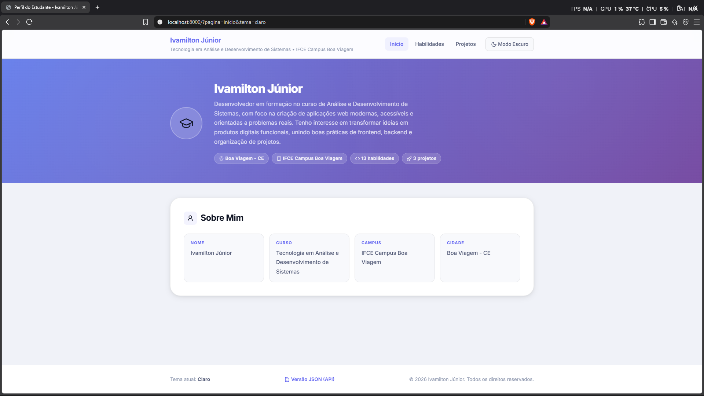
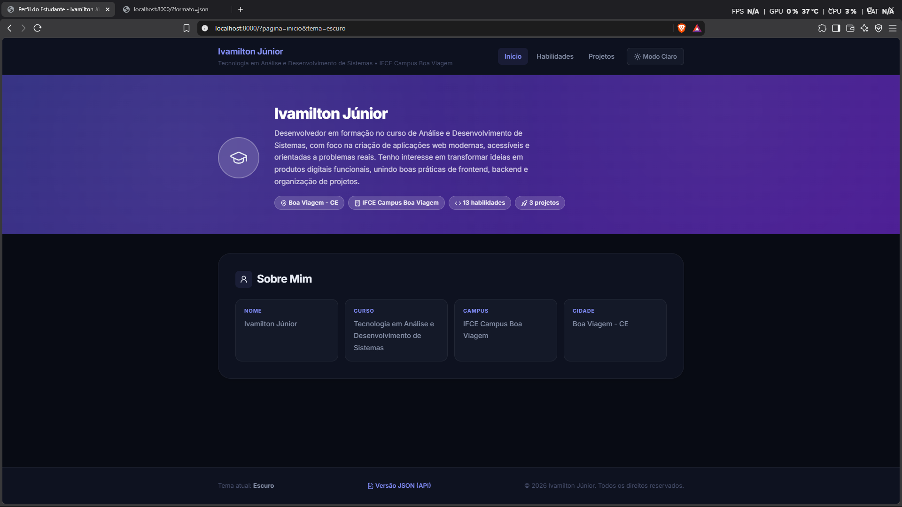

# Atividade Integrada 02 - Versão 2: Perfil do Estudante com classes

**Disciplina:** Programação Web I  
**Curso:** Tecnologia em Análise e Desenvolvimento de Sistemas (ADS)  
**Instituição:** IFCE Campus Boa Viagem  
**Professor:** Prof. Dr. Renato William Rodrigues de Souza  
**Estudante:** Ivamilton Júnior

Esta versão reescreve o projeto da [versão 1](../v1/) usando as classes
`Projeto` e `Perfil`. As páginas, os temas, os códigos de erro e a API JSON
continuam funcionando da mesma forma para quem acessa o site.

## 1. Como executar

Dentro desta pasta, inicie o servidor embutido do PHP:

```powershell
php -S localhost:8000
```

Depois, acesse `http://localhost:8000/`. Os arquivos da entrega são:

| Arquivo | Finalidade |
|---|---|
| `index.php` | Classes, objetos, rotas e HTML da aplicação |
| `estilo.css` | Estilos dos temas claro e escuro |
| `prints/claro.png` | Captura do tema claro |
| `prints/escuro.png` | Captura do tema escuro |

## 2. Telas

### Tema claro



### Tema escuro



## 3. Mapa de rotas

| Método | URL / query string | Resultado | Status |
|---|---|---|---|
| `GET` | `/` ou `/?pagina=inicio` | Apresentação do estudante | `200 OK` |
| `GET` | `/?pagina=habilidades` | Lista e contagem das habilidades | `200 OK` |
| `GET` | `/?pagina=projetos` | Cartões dos projetos com links para detalhes | `200 OK` |
| `GET` | `/?pagina=projeto&id=1` | Detalhes de Leite do Futuro | `200 OK` |
| `GET` | `/?pagina=projeto&id=2` | Detalhes de Aprende Mamis | `200 OK` |
| `GET` | `/?pagina=projeto&id=3` | Detalhes do projeto de estudos para concursos | `200 OK` |
| `GET` | `/?pagina=projeto&id=99` | Mensagem Projeto não encontrado | `404 Not Found` |
| `GET` | `/?pagina=qualquercoisa` | Mensagem Página não encontrada | `404 Not Found` |
| `GET` | `/?tema=escuro` | Ativa o escuro e salva cookie por 30 dias | `200 OK` |
| `GET` | `/?tema=claro` | Ativa o claro e salva cookie por 30 dias | `200 OK` |
| `GET` | `/?tema=<script>` | Rejeita o valor e usa o tema claro | `200 OK` |
| `GET` | `/?formato=json` | Retorna o perfil serializado em JSON | `200 OK` |

O parâmetro `tema` da URL tem prioridade sobre o cookie. Quando a URL não
informa o tema, o valor do cookie é usado; se nenhum dos dois existir, o
padrão é `claro`. A validação aceita somente `claro` e `escuro`.

## 4. Classes

### Classe `Projeto`

| Atributo | Tipo | Visibilidade | Finalidade |
|---|---|---|---|
| `$titulo` | `string` | `private` | Título do projeto |
| `$descricao` | `string` | `private` | Descrição do projeto |
| `$tecnologias` | `string` | `private` | Tecnologias utilizadas |

| Método | O que faz |
|---|---|
| `__construct(string $titulo, string $descricao, string $tecnologias)` | Inicializa o projeto e lança uma exceção se o título estiver vazio |
| `getTitulo()` | Retorna o título |
| `getDescricao()` | Retorna a descrição |
| `getTecnologias()` | Retorna as tecnologias |
| `paraArray()` | Converte os três dados em um array associativo |

O construtor usa `trim($titulo) === ''` e lança `O projeto precisa de um
título.` antes de criar um objeto inválido.

### Classe `Perfil`

| Atributo | Tipo | Visibilidade | Finalidade |
|---|---|---|---|
| `$nome` | `string` | `private` | Nome do estudante |
| `$curso` | `string` | `private` | Curso |
| `$campus` | `string` | `private` | Campus |
| `$cidade` | `string` | `private` | Cidade |
| `$apresentacao` | `string` | `private` | Texto de apresentação |
| `$habilidades` | `array` | `private` | Habilidades técnicas |
| `$projetos` | `array` | `private` | Projetos adicionados, iniciado vazio |

| Método | O que faz |
|---|---|
| `__construct(...)` | Inicializa o perfil e exige pelo menos cinco habilidades |
| `adicionarProjeto(Projeto $projeto)` | Guarda um projeto numerado a partir de 1 |
| `getProjeto(int $id)` | Retorna o projeto solicitado ou lança `Projeto não encontrado.` |
| `getNome()`, `getCurso()`, `getCampus()`, `getCidade()` | Retornam os dados do perfil |
| `getApresentacao()` | Retorna a apresentação |
| `getHabilidades()` | Retorna as habilidades |
| `getProjetos()` | Retorna a lista de projetos |
| `paraArray()` | Converte o perfil e cada projeto para arrays |

Os projetos são adicionados com:

```php
$this->projetos[count($this->projetos) + 1] = $projeto;
```

Assim, um novo projeto aparece automaticamente na listagem, na página de
detalhes e na API, sem alteração no HTML.

## 5. Antes e depois da versão 1

Na versão 1, o projeto era buscado diretamente no array:

```php
if (isset($projetos[$id_projeto])) {
    $projeto_encontrado = $projetos[$id_projeto];
} else {
    http_response_code(404);
    $mensagem_erro_404 = 'Projeto não encontrado';
}
```

Na versão 2, a responsabilidade foi transferida para o objeto `Perfil`:

```php
try {
    $projetoAtual = $perfil->getProjeto($id);
    $titulo = $projetoAtual->getTitulo();
} catch (Exception $e) {
    http_response_code(404);
    $pagina = 'nao-encontrado';
    $titulo = $e->getMessage();
}
```

Essa mudança evita acesso espalhado a chaves de arrays. A validação e a regra
de busca ficam na classe, enquanto o HTML usa apenas getters e
`foreach ($perfil->getProjetos() as $id => $proj)`.

## 6. As classes se recusam

Os testes abaixo foram feitos temporariamente e desfeitos antes da entrega:

1. Ao trocar o título de um projeto para `''`, o construtor de `Projeto`
   interrompe a criação com:

   ```text
   Fatal error: Uncaught Exception: O projeto precisa de um título.
   ```

2. Ao deixar o perfil com somente quatro habilidades, o construtor de
   `Perfil` interrompe a criação com:

   ```text
   Fatal error: Uncaught Exception: O perfil precisa de pelo menos 5 habilidades.
   ```

As exceções acontecem dentro dos construtores. Portanto, os objetos inválidos
não chegam a existir.

## 7. Saídas e testes do terminal

Com o servidor rodando em `projeto/v2`:

```powershell
curl.exe -i "http://localhost:8000/?pagina=projeto&id=2"
```

Resultado esperado: `HTTP/1.1 200 OK` e o título `Aprende Mamis`.

```powershell
curl.exe -i "http://localhost:8000/?pagina=projeto&id=99"
```

Resultado esperado: `HTTP/1.1 404 Not Found` e `Projeto não encontrado`.
O `Perfil::getProjeto()` lança a exceção e o `catch` define o status HTTP e a
página de erro.

```powershell
curl.exe -i "http://localhost:8000/?formato=json"
```

Resultado esperado: `Content-Type: application/json; charset=utf-8`, sem
HTML. O JSON tem as chaves `perfil` e `projetos`, preserva os acentos e é
formatado por `JSON_PRETTY_PRINT | JSON_UNESCAPED_UNICODE`.

Os testes de compatibilidade da versão 1 também continuam válidos:

- `?pagina=inicio`, `?pagina=habilidades` e `?pagina=projetos` retornam `200`;
- `?pagina=qualquercoisa` retorna `404`;
- `?tema=escuro` grava o cookie `tema` por 30 dias;
- uma requisição posterior com `Cookie: tema=escuro` mantém o tema escuro;
- `?tema=<script>` resulta em `tema-claro`, sem inserir a entrada no HTML.

## 8. Perguntas

### a) Por que `json_encode($perfil)` devolve `{}`?

Os atributos de `Perfil` são `private`. O `json_encode()` não serializa
diretamente esses atributos, então não encontra propriedades públicas e
produz `{}`. O método `paraArray()` expõe somente os dados necessários em uma
estrutura associativa que pode ser serializada pela API.

### b) Os objetos continuam na memória depois que a página é enviada?

Não. `Perfil`, `Projeto` e as variáveis da requisição existem durante a
execução daquele script PHP. Depois que a resposta é enviada e a requisição
termina, a memória é liberada, salvo algum mecanismo externo de persistência,
como banco de dados, arquivo ou sessão.

### c) Por que os atributos são `private` e não `public`?

`private` protege o estado interno e impede alterações arbitrárias, como
atribuir um título vazio diretamente. O acesso passa pelos métodos da classe,
que concentram validações e regras e preservam o encapsulamento.

## 9. Conceitos aplicados

- Classes, objetos, construtor e tipagem de parâmetros e propriedades;
- atributos privados e getters;
- validação com `throw` e tratamento com `try/catch`;
- arrays associativos apenas como resultado de `paraArray()`;
- `$_GET`, `$_COOKIE`, `setcookie()` e status HTTP;
- `htmlspecialchars()` em todo dado dinâmico exibido no HTML;
- `count()`, `implode()` e `foreach`;
- serialização com `json_encode()` e encerramento da rota JSON com `exit`.
